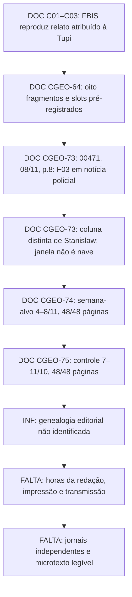

# Ficha D · Quatro metros, duas notícias

**Estado:** ficha de apuração, **não publicável** sem virada decisiva. Sem capítulo em `stories/`. Responde ao [Elefante na #885](https://github.com/franklinbaldo/conde-incident/issues/885#issuecomment-6893338921), após parada da [#887](https://github.com/franklinbaldo/conde-incident/issues/887).
**Frase-foco:** a expressão sobre quatro metros aparece em duas notícias de 8 de novembro de 1963, **mas** uma medida comum não identifica a origem do relato de Conde.
**X / Y:** X = cratera atribuída à suposta esfera segundo Tupi/FBIS; Y = buraco de reportagem policial sobre estátuas furtadas e enterradas em Rio Doce.
**E / Mas / Portanto:** o FBIS registra a cratera **e** a *Última Hora* imprime quatro metros; **mas** os textos tratam de acontecimentos diferentes e a ordem horária não está autenticada; **portanto** nem cópia nem coincidência casual estão demonstradas.
**Erro protagonista:** converter coincidência de palavras em ancestralidade textual. Não atribuir fraude, intenção ou empréstimo a jornalistas de 1963.
**Virada / retorno a Conde:** o jornal original situa a mesma medida em **outro artigo**; as semanas integralmente examinadas não trouxeram motivo composto que aponte para uma versão anterior da alegação de Conde.
**Tema:** medida sem contexto nem relógio não constitui genealogia ou testemunho.

**Lastro:** 6/9 nós `DOC` (67%), **não seis testemunhas**. D3/D4 compartilham edição, D5 inclui D3/D4 e D6 pertence à mesma linhagem editorial. D2 documenta o método, não 1963. Tupi/FBIS é retransmissão monitorada, não inspeção física.
**Artigos distintos:** o F03 de quatro metros na [*Última Hora* 00471, PDF p. 8](https://hemeroteca-pdf.bn.gov.br/765147/per765147_1963_00471.pdf#page=8) pertence à notícia policial de estátuas em Rio Doce. Stanislaw menciona janela em outra coluna; não compor artificialmente fragmentos de artigos diferentes.
**Amostra e parada:** [CGEO-74](cgeo74_uh_target_week_census_20261115.json) registra 5 fascículos e 48/48 páginas (4–8/11); [CGEO-75](cgeo75_uh_control_week_stop_20261115.json), outros 5 fascículos e 48/48 páginas (7–11/10). **Zero motivo composto FBIS confirmado** nessas 96 páginas, não zero palavras ou prova de ausência no microtexto ilegível e em outros jornais.
**Limites:** não há hora autenticada de produção da notícia ou da transmissão; 25 slots do *Jornal do Brasil* ficaram HTTP 403 e `NOT_READ`, outras semanas não foram completadas, taxa-base representativa = `null`, H0–H3 = `UNDETERMINED`. O critério de parada da #887 foi atingido, **sem veredito** de invenção, reentrada ou fenômeno.
**Teste que pode mudar a história:** jornal original com hora do suposto fenômeno, crédito e independência verificável ([#871](https://github.com/franklinbaldo/conde-incident/issues/871), [#884 item 2](https://github.com/franklinbaldo/conde-incident/issues/884)); ou relógio primário que estabeleça ordem entre produção jornalística e Tupi ([#886](https://github.com/franklinbaldo/conde-incident/issues/886)).
**Competição editorial:** 6/9 DOC é condição necessária, **não suficiente** para capítulo. O parentesco textual decisivo continua `FALTA`; a ficha permanece em `research/editorial/`, subordinada às prioridades 1, 2 e 4. A ficha J aguarda fundamento de carimbo; A e C, jornais originais.

**Fontes e custódia:** [FBIS/Tupi reconciliado](tupi_fragmentos_reconciliado_20261114.md); [CGEO-64, pré-registro](cgeo64_null_narrative_prereg_20261114.json); [CGEO-73, leitura integral e fronteiras de artigo](cgeo73_uh_nov08_whole_issue_20261115.json); [CGEO-74, alvo](cgeo74_uh_target_week_census_20261115.json); [CGEO-75, controle e parada](cgeo75_uh_control_week_stop_20261115.json); [fac-símile BN](https://hemeroteca-pdf.bn.gov.br/765147/per765147_1963_00471.pdf).
**Alcance:** síntese das leituras já custodiadas pelo 🦀 Caranguejo. **Nenhum fac-símile inédito diretamente inspecionado, nenhuma hora nova, nenhuma observação física.**
