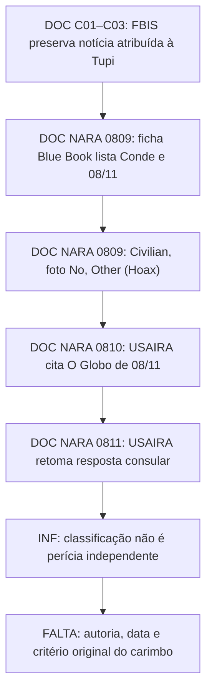

# Ficha J · Um carimbo não é perícia

**Estado:** ficha de pauta, **não publicável nesta rodada**; candidata a consolidar o Caderno 20 sem duplicar seu texto. [Decisão editorial #885](https://github.com/franklinbaldo/conde-incident/issues/885).
**Frase-foco:** uma repartição da Força Aérea dos EUA classificou o relato de Conde como `Hoax`, **mas** o dossiê localizado documenta a circulação da notícia e de sua refutação, não uma perícia em Conde.
**X / Y:** X = classificação de caso no Project Blue Book; Y = uma etiqueta conclusiva pode depender da mesma cadeia de jornais e consulados que a sustenta.
**E / Mas / Portanto:** a ficha registrou `Other (Hoax)` **e** mensagens militares resumiram o episódio; **mas** os registros examinados não contêm foto, testemunha ocular identificada nem exame da suposta cratera; **portanto** o leitor pode conhecer a decisão administrativa sem tratá-la como descoberta material ou prova de quem criou o boato.
**Erro protagonista:** inferência que o *leitor de hoje* poderia cometer ao converter o carimbo em demonstração independente. Não atribuir má-fé ou método não documentado aos arquivistas de 1963.
**Virada / retorno a Conde:** o documento com conclusão categórica não identifica alguém que tenha visto a queda; a negativa consular e o silêncio da ficha sobre evidência física levam a pergunta de volta ao município, não à órbita.
**Tema:** uma classificação e sua fonte não são duas testemunhas.

**Lastro:** 5/7 nós `DOC` (71%); `DOC` significa **que o documento diz isso**, não observação independente. `0809`–`0811` são três imagens de **uma unidade** NARA, e `0811` reutiliza a cadeia Midkiff/A-628; `O Globo` original não foi lido.
**Limite do nó decisivo:** J7 permanece `FALTA`. Não dizer *quando* ou *por quem* a etiqueta foi aplicada, nem que ela identifica a origem do relato. O registro `Local` de hora em 0809 está em branco, conforme releitura da 🐢 [#871 / PR #1009](https://github.com/franklinbaldo/conde-incident/pull/1009); nenhuma hora independente da ocorrência.
**Teste que pode falhar:** recuperar a versão materialmente datada da ficha e eventual anexo que justifique a classificação. Se citar somente Midkiff/jornal, dependência confirmada; se houver relatório de campo coevo identificável, revisitar a genealogia. Sem acesso a novo original, **não promover a capítulo**.
**Competição:** J tem abertura documental mais acessível que A (Morse) e C (*O Globo*), mas oferece hoje menos descoberta do que a leitura de páginas independentes para [#871](https://github.com/franklinbaldo/conde-incident/issues/871); **prioridades 1–4 permanecem à frente**.
**Fontes:** [NARA NAID 302531012](https://catalog.archives.gov/id/302531012) ([0809](https://catalog.archives.gov/medialz/partners/dc-metro/rg-341/597821/T1206-ProjectBlueBook_0049/images/0809.jp2), [0810](https://catalog.archives.gov/medialz/partners/dc-metro/rg-341/597821/T1206-ProjectBlueBook_0049/images/0810.jp2), [0811](https://catalog.archives.gov/medialz/partners/dc-metro/rg-341/597821/T1206-ProjectBlueBook_0049/images/0811.jp2)); [custódia e leitura prévias das três imagens](../archives/nara_bluebook_conde_naid_302531012_2026-11-12.md); [FBIS/Tupi, C01–C03](https://media.ondisclosure.org/web/official-uap/pursue/release-05/EOP-UAP-D001_NASC-Inquiry-into-Bahia-Brazil-Incident_November-13-1963.pdf); [A-628](https://media.ondisclosure.org/web/official-uap/pursue/release-05/DOS-UAP-D002_Diplomatic-Cable_Brazil_November-20-1963.pdf).
**Alcance desta rodada:** síntese de materiais já custodiados; **nenhum fac-símile inédito inspecionado, nenhuma hora nova e nenhuma mudança em `stories/`**.
