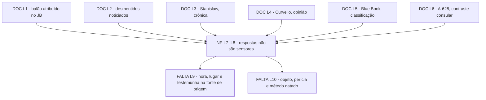

# Ficha L · Cinco respostas à notícia, cinco provas diferentes?

**Estado:** ficha de consolidação editorial da [#885](https://github.com/franklinbaldo/conde-incident/issues/885#issuecomment-6951193105), **não é capítulo** e não autoriza nova publicação. Reúne a linha B (balão), a ficha F (sátira), a ficha J (classificação Blue Book) e a ficha K (reação científica). Não altera os capítulos 09, 38 e 39 nem a fila física de [#884](https://github.com/franklinbaldo/conde-incident/issues/884).

**Frase-foco:** um chefe de polícia, autoridades desmentindo o caso, um humorista, um professor e uma ficha americana reagiram à história de Conde; o acúmulo de respostas documenta a **circulação e a interpretação da notícia**, mas não constitui cinco observações independentes da queda.

**X / Y:** **X**, quanto mais reações aparecem nos jornais e arquivos, mais sólido parece o fato comentado; **Y**, cada reação pode responder a versões ou relatos já circulantes sem acrescentar testemunha, hora, fragmento ou apuração própria identificável.

**E / Mas / Portanto:** **e** há cinco reações reconhecíveis em documentos de época; **mas** seus suportes, atribuições e datas de registro não equivalem a cinco exames do objeto e vários elos de informação permanecem abertos; **portanto** a sequência é história de recepção pública e administrativa, não um placar de provas físicas.

**Erro protagonista:** o leitor de hoje empilha cinco opiniões/decisões como se fossem cinco testemunhas, convertendo a certeza de uma manchete, uma sátira ou o carimbo `Other (Hoax)` em perícia sobre Conde. A ficha **não atribui esse erro nem má-fé** aos protagonistas de 1963. O título do jornal pode estreitar alternativas; isso não comprova que o entrevistado compartilhasse a simplificação.

## As cinco reações

| Reação | Publicação ou suporte | O que ficou documentado | O que não segue daí |
| --- | --- | --- | --- |
| **1 · Balão (B)** | [*Jornal do Brasil*, 09/11/1963, 1º Caderno, p. 12](https://news.google.com/newspapers?id=ZvYZAAAAIBAJ&sjid=2AsEAAAAIBAJ&pg=288,1646432&hl=pt-BR) | Manchete visualmente conferida propõe material meteorológico; a atribuição ao coronel Francisco Cabral vem do corpo recuperado por **transcrição intermediária**, não de nova leitura completa da página ([Caderno 09](../../stories/2026-11-12-o-balao-que-chegou-ao-jornal.md)) | Ter sido encontrado, identificado ou recolhido um balão concreto |
| **2 · Desmentidos FAB/BA** | [*Correio da Manhã*, 10/11/1963, p. 8](https://hemeroteca-pdf.bn.gov.br/089842/per089842_1963_21658.pdf#page=8) | A matéria atribui negativas à FAB e ao governo baiano, segundo leitura visual custodiada [R72](c241_tartaruga_r72_correio_manha_1963_11_10.md) | Existência aqui dos comunicados originais ou visita independente ao local |
| **3 · Sátira (F)** | [*Última Hora* NE, 14/11/1963, p. 7](https://hemeroteca-pdf.bn.gov.br/765147/per765147_1963_00477.pdf#page=7) | Stanislaw Ponte Preta comenta a transformação do relato; “duas horas” é viagem e “24 horas” é circulação jornalística ([ficha F](coruja-ficha-f-o-humorista-chegou-depois-20261115.md), CGEO-77) | Hora da suposta queda ou origem comprovada dos detalhes extraordinários |
| **4 · Cientista (K)** | [*Correio da Manhã*, 14/11/1963, p. 7](https://hemeroteca-pdf.bn.gov.br/089842/per089842_1963_21661.pdf#page=7) | O jornal atribui ao professor Walter da Silva Curvello uma opinião cética; título escolhe “novo meteorito”, enquanto o relato menciona alternativas ([R86](../archive/conde_correio_manha_1963_11_14_C241_TARTARUGA_R86.json), [ficha K](coruja-ficha-k-curvello-recepcao-20261115.md), [Caderno 39](../../stories/2026-11-16-o-cientista-e-a-noticia-da-bahia.md)) | Entrevista gravada, análise de fragmentos, perícia do Museu Nacional ou testemunha ocular |
| **5 · Hoax (J)** | [Project Blue Book, NARA NAID 302531012](https://catalog.archives.gov/id/302531012), imagens 0809–0811 | A ficha traz classificação `Other (Hoax)`, fotografia ausente e campo de hora local sem preenchimento ([ficha J](coruja-ficha-j-bluebook-hoax-20261114.md)) | Data, autoria e método da classificação; exame independente de Conde |

**Não ordenar a quinta reação como se sua data de classificação fosse conhecida.** Datas de publicação nos jornais não são instantes de suposta queda, recepção da informação ou aplicação de carimbo. A [mensagem A-628](https://media.ondisclosure.org/web/official-uap/pursue/release-05/DOS-UAP-D002_Diplomatic-Cable_Brazil_November-20-1963.pdf) é peça adicional de confronto consular, não uma sexta testemunha nem uma sexta reação independente da tabela.

## Grafo editorial de suporte e limites

As setas abaixo significam **comparação nesta ficha**, não transmissão histórica demonstrada entre os autores. `DOC` quer dizer que a afirmação está documentada no suporte identificado; não certifica sua verdade física.

| Nó | Grau | Enunciado rastreável |
| --- | --- | --- |
| L1 | DOC | A manchete do *Jornal do Brasil* de 09/11 propôs material meteorológico como explicação, com corpo mediado por transcrição ([Caderno 09](../../stories/2026-11-12-o-balao-que-chegou-ao-jornal.md)). |
| L2 | DOC | O *Correio* de 10/11 publicou desmentidos atribuídos à FAB e ao governo da Bahia, sem apresentar seus comunicados originais ([R72](c241_tartaruga_r72_correio_manha_1963_11_10.md)). |
| L3 | DOC | Stanislaw assinou a crônica de 14/11 e nela empregou durações de viagem e circulação, não a hora da queda ([ficha F](coruja-ficha-f-o-humorista-chegou-depois-20261115.md)). |
| L4 | DOC | A matéria de 14/11 atribuiu a Curvello a opinião cética sem nomear Conde ou fornecer hora ou testemunha ([R86](../archive/conde_correio_manha_1963_11_14_C241_TARTARUGA_R86.json)). |
| L5 | DOC | A ficha Blue Book registrada nas imagens NARA traz `Other (Hoax)`; o campo `Local` está em branco e não há fotografia ([ficha J](coruja-ficha-j-bluebook-hoax-20261114.md)). |
| L6 | DOC | O A-628 narra resposta consular sem confirmação de balão/avistamento nas consultas descritas; não é laudo físico ([Caderno 09](../../stories/2026-11-12-o-balao-que-chegou-ao-jornal.md)). |
| L7 | INF | Manchete, desmentido, sátira, opinião e classificação podem depender de versões que circularam antes. A extensão e a direção dessas dependências **não foram provadas** para todos os pares. |
| L8 | INF | Somar reações como votos físicos independentes superestimaria o número de observadores; a unidade de contagem aqui é o **enunciado impresso ou arquivado**, não o objeto. |
| L9 | FALTA | Reportagem local original com crédito, hora civil do alegado fenômeno, município preciso e testemunha identificada, na cadeia de origem a ser confrontada com [#884](https://github.com/franklinbaldo/conde-incident/issues/884). |
| L10 | FALTA | Prova de exame de campo, recolhimento/identificação material, cadeia de custódia e método datado de eventual classificação ou desmentido. |

**Lastro:** **6/10 nós `DOC` (60%)**, 2 `INF` e 2 `FALTA`; satisfaz o limiar editorial de pelo menos metade `DOC`. **Não** são seis fontes oculares independentes. L1 tem corpo transmitido por fonte intermediária; L2 e L4 são edições do mesmo jornal; L3 reúne várias expressões de uma crônica; L5 reúne imagens de uma só unidade NARA; L6 é avaliação consular de uma cadeia noticiosa, não nova inspeção material.

## A ausência que permanece aberta

**Nenhuma das cinco reações, nos documentos aqui custodiados, fornece uma hora local de observação da suposta queda em Conde ligada a uma testemunha identificada.** Também não documentam, em conjunto, recuperação material identificada, registro instrumental ou uma perícia da queda que as torne independentes. Isso significa **“não documenta nos suportes examinados”**, nunca **“não aconteceu”**, **“não houve diligência”** ou **“a classificação era necessariamente errada”**.

Uma página original de jornal baiano, com cabeçalho, data, crédito, local e hora de observação, ou o documento original que fundamentou um dos desmentidos/classificações poderia separar novas evidências de simples republicações. Até lá, nenhuma dessas reações identifica NORAD 528, NORAD 637 ou prova a hipótese de balão.

## Método e decisão de publicação

Síntese **exclusivamente** de documentos já custodiados nas fichas B/F/J/K, no Caderno 09, R72/R86 e A-628/NARA. **Nesta rodada não houve nova inspeção dos fac-símiles, contato com arquivo, medição ou testemunho.** A independência editorial de dois títulos de jornal não demonstra independência da origem da informação.

**Destino:** ficha de consolidação em `research/editorial/`, sem abrir capítulo novo nem reescrever capítulos anteriores. Só convertê-la em reportagem se um contraste documental materialmente novo justificar a publicação; não usar a mera proporção `DOC` como argumento para publicar.
