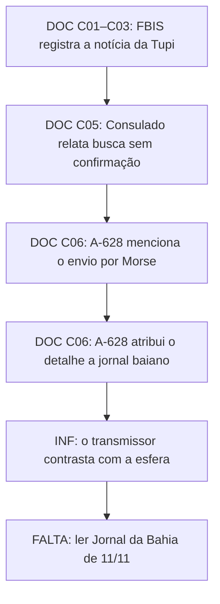

# Oficina da Coruja: dez linhas antes de um capítulo

**Estado:** pauta privada de publicação (arquivo público de pesquisa, fora de `stories/` e do SSG); nenhuma destas linhas é fato novo. **Critério:** até um capítulo novo por dia local de Porto Velho, e nenhum sem ficha com pelo menos metade dos nós `DOC`. Fontes repetidas são **nós documentais**, não testemunhas independentes. [Contrato #885](https://github.com/franklinbaldo/conde-incident/issues/885).

## Leque comparável: X, Y e a virada em uma linha

| Linha | X e Y (a surpresa que devolve a Conde) | E / Mas / Portanto | Lastro e destino |
| --- | --- | --- | --- |
| **A · Morse, não nave** | Uma notícia viaja de Conde a Salvador; o detalhe que o jornal destacava era um transmissor terrestre. | **E** um repórter teria usado código Morse; **mas** o relato da esfera não ganhou vestígio; **portanto** a notícia sobre o meio de comunicação não confirma o objeto alegado. | [C06, A-628](https://media.ondisclosure.org/web/official-uap/pursue/release-05/DOS-UAP-D002_Diplomatic-Cable_Brazil_November-20-1963.pdf); **selecionada para ficha**, falta jornal original. |
| **B · O balão sem balão** | Uma autoridade oferece uma explicação natural; o próprio inquérito não encontra o exemplar físico. | **E** o *Jornal do Brasil* noticia balão; **mas** o A-628 registra ausência de confirmação; **portanto** hipótese publicada não equivale a objeto encontrado. | [C77–C84, Caderno 09](../../stories/2026-11-12-o-balao-que-chegou-ao-jornal.md); **consolidar**, não duplicar. |
| **C · Jornal visto por empréstimo** | Um adido americano lê referência a *O Globo* de 8/11; nossa investigação ainda não leu a página. | **E** o telegrama de 14/11 cita o jornal; **mas** falta edição, crédito e texto; **portanto** a anterioridade sobre a Tupi não é demonstrada. | [NARA 0810, Caderno 20](../../stories/2026-11-13-o-jornal-na-mensagem-militar.md); **apuração**. |
| **D · Quatro metros duas vezes** | A mesma grandeza aparece em duas matérias diferentes do mesmo dia; a dependência entre as redações está aberta. | **E** FBIS/Tupi fala em cratera; **mas** *Última Hora* fala em buraco para estátuas; **portanto** é preciso medir taxa-base antes de dizer que houve empréstimo. | [C01–C03 e nota original](tupi_fragmentos_reconciliado_20261114.md); **aguardar #887**, 🦀 responsável. |
| **E · A máquina ganha passageiro** | Uma esfera vira veículo tripulado nas versões do noticiário; o ocupante aparece como texto, não como pessoa identificada. | **E** FBIS registra corpo; **mas** não registra testemunha nomeada ou laudo; **portanto** há genealogia de relato a buscar. | [C03, FBIS](https://media.ondisclosure.org/web/official-uap/pursue/release-05/EOP-UAP-D001_NASC-Inquiry-into-Bahia-Brazil-Incident_November-13-1963.pdf); **depende de originais baianos**. |
| **F · O humorista chegou depois** | A sátira entende a metamorfose da notícia; os elementos extraordinários já eram impressos antes. | **E** Stanislaw escreve em 14/11; **mas** o jornal de 9/11 já traz “tripulado”; **portanto** sátira não é cronologia primária da circulação. | [C04, Caderno 09](../../stories/2026-11-12-o-balao-que-chegou-ao-jornal.md); **consolidar**. |
| **G · Dois relógios na mesma frase** | Um marcador FBIS parece hora de acontecimento; pode ser apenas horário de monitoramento em outro fuso. | **E** o registro traz `2330`; **mas** a convenção exata não foi calibrada; **portanto** nenhuma hora de queda é conhecida. | [FBIS e Caderno 37](../../stories/2026-11-14-duas-horas-para-a-mesma-noticia.md); **já narrada**, não republicar. |
| **H · Uma letra, dois satélites** | Quatro números concordantes pertencem ao objeto A; a reentrada investigada é do B. | **E** as tabelas repetem a órbita; **mas** identificam 1963-003A; **portanto** elas não localizam o 528 em Conde. | [Caderno 36](../../stories/2026-11-14-o-satelite-secreto-em-duas-tabelas.md); **já narrada**. |
| **I · O centro sem endereço** | A rádio diz “centro de Conde”; mapas e praças de épocas diferentes não localizam o alegado lugar. | **E** um livro de 1958 nomeia uma praça; **mas** a divisão municipal de 2020 não pode ser retroprojetada; **portanto** a geografia de 1963 segue uma pergunta. | [Caderno das fotos](../../stories/2026-11-12-oito-fotografias-antes-da-esfera.md); **fonte coeva pendente**. |
| **J · Um carimbo não é perícia** | O Blue Book classifica o caso administrativamente; a ficha não fotografa, mede ou visita a cratera. | **E** a ficha usa `Hoax`; **mas** cita registros dependentes; **portanto** o carimbo não demonstra origem do rumor nem impacto. | [NARA 0809 e Caderno 20](../../stories/2026-11-13-o-jornal-na-mensagem-militar.md); **possível consolidação**. |

## Ficha A: o telegrama que valeu a viagem

- **Frase-foco:** um correspondente teria viajado para esclarecer a esfera porque se falava em um achado extraordinário, **mas** o detalhe que o A-628 atribui à matéria é a comunicação por telégrafo de Conde a Salvador.
- **X / Y:** X = repórter transmite notícia; Y = o documento descreve a transmissão terrestre com mais concretude do que o objeto que motivou a viagem.
- **E / Mas / Portanto:** a Tupi divulgou a esfera **e** jornalistas teriam procurado evidências; **mas** o consulado não encontrou confirmação e citou um jornalista fascinado pelo telégrafo; **portanto** a história é sobre como se verifica e comunica um rumor.
- **Erro protagonista:** **risco de leitura atual**, não culpa atribuída a jornalista histórico: transformar a descrição diplomática do recorte em prova de cratera, testemunha independente ou texto integral lido.
- **Ritmo e retorno:** primeiro o aparelho Morse, depois os papéis que o citam, por fim o contraste com a notícia original de Conde. Sem simular a redação de 1963 nem atribuir intenção.
- **Dependência:** os nós A3 e A4 vêm do **mesmo A-628**, que por sua vez reproduz a resposta consular e descreve recorte não recuperado. `DOC` indica frase documentada, **não** confirmação independente.

**Proporção documental:** 4/6 nós `DOC` (67%). São enunciados *sobre o conteúdo de documentos*, e não quatro testemunhos independentes do mesmo acontecimento. **Ainda não pronta para publicação**: sem a edição original do *Jornal da Bahia* não há citação literal segura do repórter ou garantia de que o A-628 preservou o contexto.

**Teste dirigido:** localizar o fac-símile de *Jornal da Bahia*, 11/11/1963, edição/página/crédito; confrontar a menção do Morse e o despacho original. Se divergir, manter a versão diplomática como *relato de recorte*, jamais corrigir silenciosamente o passado. Não contatar arquivos ou pessoas sem autorização.

**Fontes de lastro:** [FBIS/Tupi, 08/11/1963 (C01–C03)](https://media.ondisclosure.org/web/official-uap/pursue/release-05/EOP-UAP-D001_NASC-Inquiry-into-Bahia-Brazil-Incident_November-13-1963.pdf); [A-628, 20/11/1963, com resposta de 14/11 (C05–C10)](https://media.ondisclosure.org/web/official-uap/pursue/release-05/DOS-UAP-D002_Diplomatic-Cable_Brazil_November-20-1963.pdf); [matriz C001–C238](../evidence_matrix_C001-C238_2026-11-11.md). Nenhum novo documento primário foi recuperado nesta rodada.

## Comparação das alternativas (0–3)

Escala: 0 = inexistente; 1 = frágil; 2 = parcial; 3 = nítido. **Personagem** = pessoa/ator documentado; **virada** = contraste real; **cena** = detalhe concreto sem imaginação; **retorno** = conexão com Conde; **tema** = questão humana maior; **lastro** = documentos de origem identificada. Notas são julgamento editorial, não pesos de probabilidade científica.

| Linha | Personagem | Virada | Cena | Retorno | Tema | Lastro | Soma | Decisão |
| --- | ---: | ---: | ---: | ---: | ---: | ---: | ---: | --- |
| A · Morse | 2 | 3 | 2 | 3 | 3 | 2 | 15 | Desenvolver após fac-símile |
| B · Balão | 2 | 3 | 2 | 3 | 3 | 3 | 16 | Consolidar Caderno 09 |
| C · O Globo | 2 | 3 | 1 | 3 | 3 | 2 | 14 | Apuração |
| D · Quatro metros | 1 | 2 | 2 | 3 | 3 | 2 | 13 | Aguardar corpus #887 |
| E · Tripulado | 1 | 2 | 1 | 3 | 3 | 2 | 12 | Apuração |
| F · Stanislaw | 3 | 3 | 2 | 3 | 3 | 3 | 17 | Consolidar Cadernos |
| G · Relógio | 1 | 3 | 2 | 3 | 3 | 2 | 14 | Já publicado |
| H · Letra | 0 | 3 | 1 | 2 | 3 | 3 | 12 | Já publicado |
| I · Centro | 1 | 2 | 2 | 3 | 2 | 2 | 12 | Fonte de 1963 pendente |
| J · Hoax | 1 | 3 | 2 | 3 | 3 | 3 | 15 | Consolidar Caderno 20 |

**Mapa da série:** A (notícia e verificação) pode seguir C (imprensa e precedência) quando o jornal original aparecer; B+F (origem/negação e sátira) são um arco de consolidação; D+E (genealogia dos motivos) depende de #887; G+H (tempo e objetos) já contam como episódios publicados. **Não iniciar um segundo capítulo de 14/11.**
